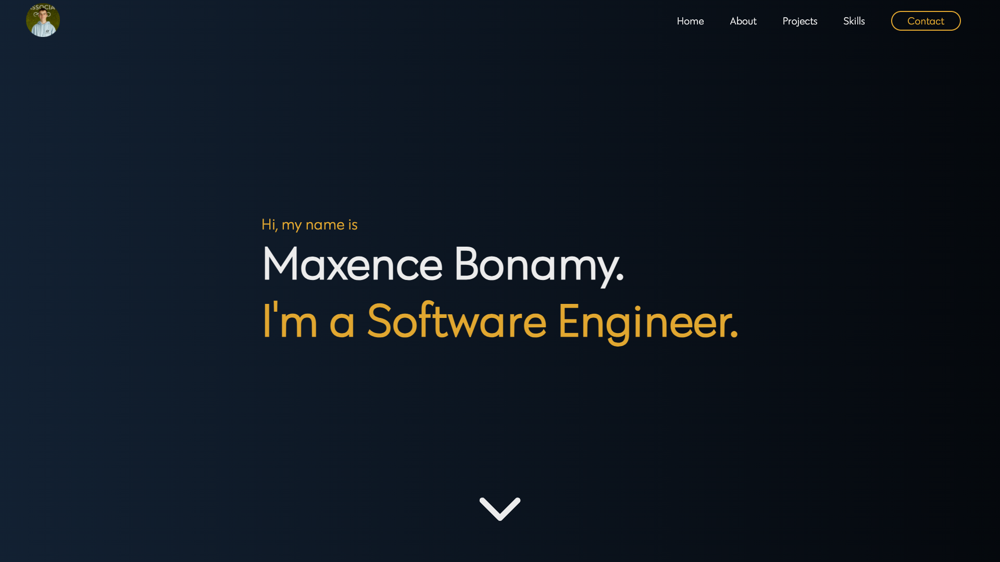

# Portfolio v2

Personal portfolio of Maxence Bonamy.

Single-page website presenting the author, a list of personal programming projects with an animated preview and the technologies they use, a skills overview and contact links. This is the second version of the portfolio and is not hosted anywhere.



## Table of contents

- [Portfolio v2](#portfolio-v2)
	- [Table of contents](#table-of-contents)
	- [How it works](#how-it-works)
	- [Tech stack](#tech-stack)
	- [Repository structure](#repository-structure)
	- [Prerequisites](#prerequisites)
	- [Installation](#installation)
	- [Running locally](#running-locally)
	- [Useful scripts](#useful-scripts)
	- [Tests and quality](#tests-and-quality)
	- [License](#license)

## How it works

1. **Layout**: `src/App.js` renders the sections in a single page, in this order: navigation bar, home, about, projects, skills, contact, footer. The navigation bar links to each section by anchor.
2. **Projects**: the section reads `src/projects/projects.json`, which lists 8 projects. Each card has a GIF preview, the skills used, a GitHub link and a download link.
3. **Skills**: the section reads `src/skills/skills.json` and shows icons grouped in four categories (software, hardware, web, design). Clicking a category name switches the displayed group.
4. **Contact**: the section reads `src/contact/contact.json` and lists the links to LinkedIn, Twitter, Instagram, GitHub and e-mail.
5. **Styling**: each component has its own SCSS file, imported through its compiled CSS. The Klik Light font is loaded from `src/_fonts`.

## Tech stack

| Layer | Technologies |
| --- | --- |
| Frontend | React 18, Create React App (`react-scripts` 5) |
| Styles | SCSS compiled to CSS, committed next to each source file |
| Icons | Font Awesome (npm packages), WebP skill and contact icons |
| Assets | GIF previews, WebP images, local font (`Klik-Light`) |
| Tests | Jest, React Testing Library |

## Repository structure

```
.
├── assets/
│   └── hero.png        README screenshot
├── public/             HTML template, manifest, icons, robots.txt
└── src/
    ├── _fonts/         Local font
    ├── _utils/         Shared colors, text styles and profile picture
    ├── about/          About section
    ├── contact/        Contact section, icons and contact.json
    ├── footer/         Footer
    ├── home/           Home section
    ├── navbar/         Navigation bar
    ├── projects/       Projects section, GIF previews and projects.json
    ├── skills/         Skills section, icons and skills.json
    ├── App.js          Page composition
    └── index.js        Entry point
```

Each section has its own folder with a component, a `.scss` source and the compiled `.css` and `.css.map`. The JSON files next to the components hold the displayed content, so adding a project or a skill does not require changing a component.

## Prerequisites

- [Node.js](https://nodejs.org/) and npm
- [Sass](https://sass-lang.com/install) only if you edit the `.scss` files

## Installation

```bash
git clone git@github.com:maxencebonamy/Portfolio-V2.git
cd Portfolio-V2
npm install
```

## Running locally

```bash
npm start
```

The site is then available at <http://localhost:3000>. The project does not use environment variables.

## Useful scripts

| Command | Effect |
| --- | --- |
| `npm start` | Start the development server |
| `npm run build` | Build the application into `build/` |
| `npm test` | Run the tests in watch mode |
| `sass src/app.scss src/app.css` | Compile a stylesheet (same pattern for each `.scss` file) |

## Tests and quality

```bash
npm test
```

The only test, `src/App.test.js`, is the default Create React App one: it looks for a "learn react" link that the page does not contain, so it fails. ESLint runs through the `react-app` configuration when the application is started or built.

## License

This project is licensed under the [MIT License](LICENSE.md).
